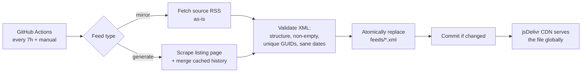

# rss-mirror-feeds

[](https://github.com/unclemicdo/rss-mirror-feeds/actions/workflows/update.yml)

Mirror or generate podcast/blog RSS feeds and serve them via jsDelivr CDN —
a stable, free, zero-maintenance subscribe endpoint.

Feeds are refreshed every 7 hours by GitHub Actions; only valid RSS/Atom XML is
committed, and failed refreshes keep the last known good file.

## Subscribe

| Feed | Subscribe URL |
|---|---|
| Dwarkesh Podcast | [feed_dwarkesh.xml](https://cdn.jsdelivr.net/gh/unclemicdo/rss-mirror-feeds@main/feeds/feed_dwarkesh.xml) |
| Y Combinator Startup Podcast | [feed_yc_startup.xml](https://cdn.jsdelivr.net/gh/unclemicdo/rss-mirror-feeds@main/feeds/feed_yc_startup.xml) |
| Anthropic Engineering | [feed_anthropic_engineering.xml](https://cdn.jsdelivr.net/gh/unclemicdo/rss-mirror-feeds@main/feeds/feed_anthropic_engineering.xml) |
| Anthropic News | [feed_anthropic_news.xml](https://cdn.jsdelivr.net/gh/unclemicdo/rss-mirror-feeds@main/feeds/feed_anthropic_news.xml) |

Copy the link into any podcast or RSS app. Entry GUIDs are preserved, so
switching your subscription to this mirror does not re-mark old items as new.

## How it works



Two refresh strategies, one shared pipeline:

- **`mirror`** — the source already publishes RSS; bytes are mirrored as-is.
  GUIDs and dates are inherited from the source with zero conversion.
- **`generate`** — the site has no RSS (e.g. anthropic.com). A site-specific
  extractor pulls entries from the page, they are merged with the checked-in
  history in `cache/` (so old posts survive source-side truncation and URL
  migrations), and RSS 2.0 is built from scratch.

All output — mirrored or generated — passes the same validation before
publication: parses as RSS/Atom, at least one entry, no duplicate GUIDs, no
future-dated items. Invalid output never replaces the published file; a
failing feed never blocks the others (and marks the CI run failed so it stays
visible).

## Add your own feed

1. Fork this repo (Actions are enabled by default).
2. Add an entry to `FEEDS` in [`scripts/feeds_registry.py`](scripts/feeds_registry.py):
   ```python
   {
       "name": "feed_myshow",
       "type": "mirror",   # source already has RSS
       "url": "https://example.com/myshow/rss",
       "enabled": True,
   },
   ```
   For a site without RSS, set `"type": "generate"`, point `"generator"` at a
   module in `scripts/generate/` (see `anthropic.py` for the pattern), and add
   the feed's channel metadata.
3. Push. The next run refreshes it, and your subscribe URL is:
   ```
   https://cdn.jsdelivr.net/gh/<your-user>/rss-mirror-feeds@main/feeds/feed_myshow.xml
   ```

## Notes

- jsDelivr caches branch refs for up to ~12 hours; new items may appear with
  that delay.
- Audio enclosures keep pointing at the original host — this repo only
  mirrors/generates the XML, not the media.

## License

[MIT](LICENSE)
