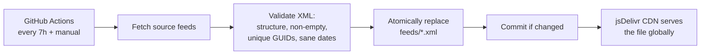

# rss-mirror-feeds

[](https://github.com/unclemicdo/rss-mirror-feeds/actions/workflows/update.yml)

Mirror podcast RSS feeds into this repo and serve them via jsDelivr CDN — a
stable, free, zero-maintenance subscribe endpoint.

Feeds are refreshed every 7 hours by GitHub Actions; only valid RSS/Atom XML is
committed, and failed fetches keep the last known good file.

## Subscribe

| Feed | Subscribe URL |
|---|---|
| Dwarkesh Podcast | [feed_dwarkesh.xml](https://cdn.jsdelivr.net/gh/unclemicdo/rss-mirror-feeds@main/feeds/feed_dwarkesh.xml) |
| Y Combinator Startup Podcast | [feed_yc_startup.xml](https://cdn.jsdelivr.net/gh/unclemicdo/rss-mirror-feeds@main/feeds/feed_yc_startup.xml) |

Copy the link into any podcast or RSS app. Entry GUIDs are preserved
byte-for-byte from the source, so switching your subscription to this mirror
does not re-mark old episodes as new.

## How it works



- **Validation before publication** — a feed is only committed if it parses as
  RSS/Atom, has at least one entry, no duplicate GUIDs, and a plausible newest
  timestamp. Invalid output never replaces the published file.
- **Fail-safe** — if a source is down, the last known good XML stays served.
- **No timestamp-only commits** — unchanged feeds are not re-committed.

## Add your own feed

1. Fork this repo (Actions are enabled by default).
2. Add an entry to `SOURCES` in [`scripts/update_feeds.py`](scripts/update_feeds.py):
   ```python
   "feed_myshow.xml": "https://example.com/myshow/rss",
   ```
3. Push. The next run mirrors it, and your subscribe URL is:
   ```
   https://cdn.jsdelivr.net/gh/<your-user>/rss-mirror-feeds@main/feeds/feed_myshow.xml
   ```

This works for any feed that already publishes RSS and is unreachable,
unstable, or rate-limited from your reader's network. To *generate* feeds for
sites without RSS, see [Olshansk/rss-feeds](https://github.com/Olshansk/rss-feeds).

## Notes

- jsDelivr caches branch refs for up to ~12 hours; new episodes may appear
  with that delay.
- Audio enclosures keep pointing at the original host — this mirror only
  mirrors the XML, not the media.

## License

[MIT](LICENSE)
